<a href="#contests"></a>

<p align="center">
  <a href="#contests">Контесты&nbsp;›</a>&emsp;
  <a href="#editorials">Разборы&nbsp;›</a>&emsp;
  <a href="#algorithms">Алгоритмы&nbsp;›</a>&emsp;
  <a href="#structure">Структура&nbsp;›</a>&emsp;
  <a href="#run">Запуск&nbsp;›</a>
</p>

<br>


<br>
<br>

<p align="center">
  <i>«Talk is cheap. Show me the code.»</i><br>
  <sub>— Linus Torvalds</sub>
</p>

<br>

<a name="contests"></a>
<picture>
  <source media="(prefers-color-scheme: dark)" srcset="assets/titles/contests-dark.svg">
  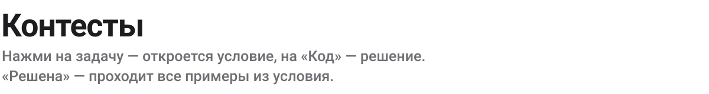
</picture>

<a href="contests/2026-icpc-kyrgyzstan-qual/statements"></a>

<p>
<a href="contests/2026-icpc-kyrgyzstan-qual/statements/A.pdf"></a><a href="contests/2026-icpc-kyrgyzstan-qual/solutions/A.py">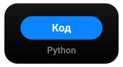</a><br>
<a href="contests/2026-icpc-kyrgyzstan-qual/statements/B.pdf"></a><a href="contests/2026-icpc-kyrgyzstan-qual/solutions/B.py"></a><br>
<a href="contests/2026-icpc-kyrgyzstan-qual/statements/C.pdf"></a><a href="contests/2026-icpc-kyrgyzstan-qual/solutions/C.py"></a><br>
<a href="contests/2026-icpc-kyrgyzstan-qual/statements/D.pdf"></a><a href="contests/2026-icpc-kyrgyzstan-qual/solutions/D.py"></a><br>
<a href="contests/2026-icpc-kyrgyzstan-qual/statements/E.pdf"></a><a href="contests/2026-icpc-kyrgyzstan-qual/statements/E.pdf">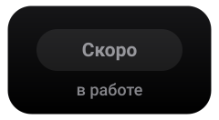</a><br>
<a href="contests/2026-icpc-kyrgyzstan-qual/statements/H.pdf"></a><a href="contests/2026-icpc-kyrgyzstan-qual/statements/H.pdf"></a><br>
</p>

<br>

<a name="editorials"></a>
<picture>
  <source media="(prefers-color-scheme: dark)" srcset="assets/titles/editorials-dark.svg">
  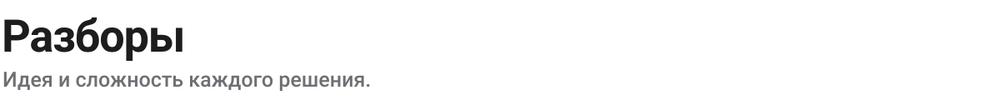
</picture>

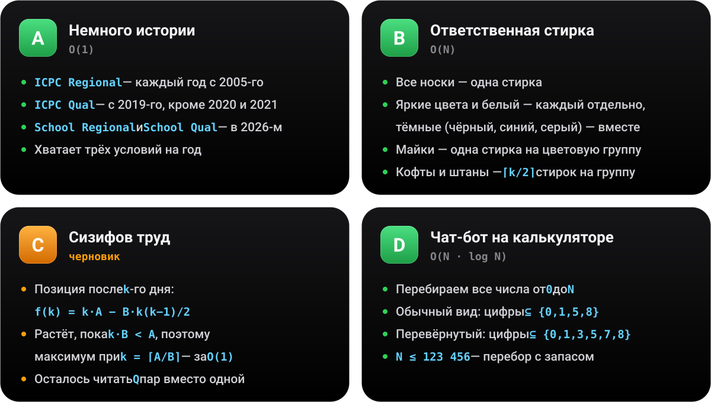

<br>
<br>

<a name="algorithms"></a>
<picture>
  <source media="(prefers-color-scheme: dark)" srcset="assets/titles/algorithms-dark.svg">
  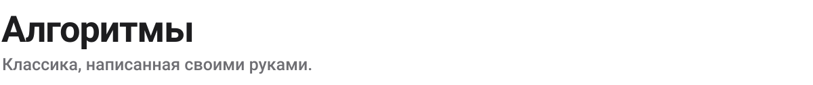
</picture>

<a href="algorithms/sorting/bubble_sort_swaps.cpp">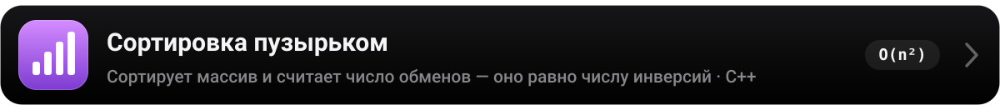</a>

<br>
<br>

<a name="cpp"></a>
<picture>
  <source media="(prefers-color-scheme: dark)" srcset="assets/titles/cpp-dark.svg">
  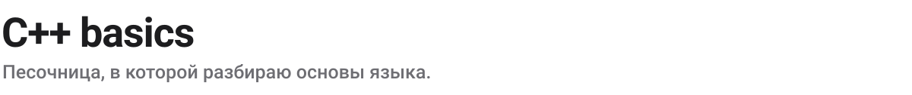
</picture>

<a href="cpp-basics/hello.cpp"></a>
<a href="cpp-basics/f1.cpp"></a>

<br>
<br>

<a name="structure"></a>
<picture>
  <source media="(prefers-color-scheme: dark)" srcset="assets/titles/structure-dark.svg">
  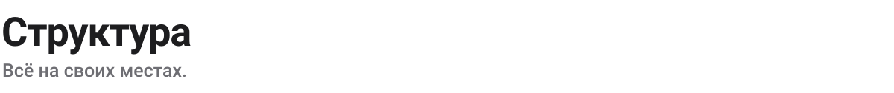
</picture>


<br>
<br>

<a name="run"></a>
<picture>
  <source media="(prefers-color-scheme: dark)" srcset="assets/titles/run-dark.svg">
  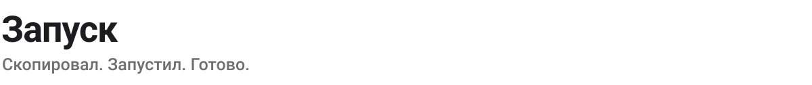
</picture>


<details>
<summary>Скопировать команды</summary>
<br>

```bash
# Python
python3 contests/2026-icpc-kyrgyzstan-qual/solutions/D.py <<< 34
# 8 15

# C++
clang++ -std=c++17 -O2 algorithms/sorting/bubble_sort_swaps.cpp -o bubble
echo "4  4 2 3 1" | ./bubble
# 5
```

</details>

<br>


<p align="center">
  <sub>Сделано с ☕ и <code>-O2</code> &nbsp;·&nbsp; <a href="https://github.com/a1tvv">@a1tvv</a></sub>
</p>
