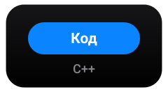
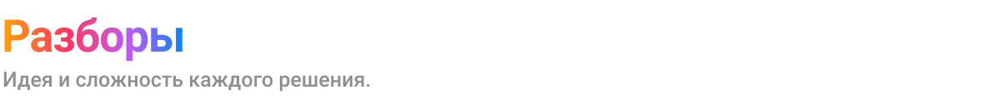
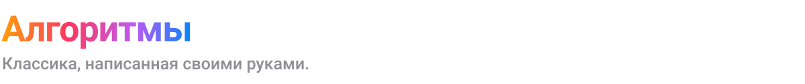
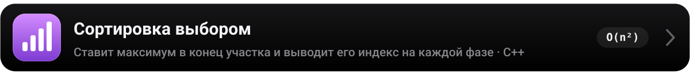

<!-- Этот файл собирается автоматически: python3 scripts/build.py. Правки вручную перезапишутся. -->
<a href="#contests"></a>

<p align="center">
  <a href="#contests">Контесты&nbsp;›</a>&emsp;
  <a href="#editorials">Разборы&nbsp;›</a>&emsp;
  <a href="#algorithms">Алгоритмы&nbsp;›</a>&emsp;
  <a href="#structure">Структура&nbsp;›</a>&emsp;
  <a href="#run">Запуск&nbsp;›</a>
</p>

<br>


<br>
<br>

<p align="center">
  <i>«Talk is cheap. Show me the code.»</i><br>
  <sub>— Linus Torvalds</sub>
</p>

<br>

<a name="contests"></a>


<a href="contests/2026-icpc-qual/statements"></a>

<p>
<a href="contests/2026-icpc-qual/statements/A.pdf"></a><a href="contests/2026-icpc-qual/solutions/A.py"></a><br>
<a href="contests/2026-icpc-qual/statements/B.pdf"></a><a href="contests/2026-icpc-qual/solutions/B.py"></a><br>
<a href="contests/2026-icpc-qual/statements/C.pdf"></a><a href="contests/2026-icpc-qual/solutions/C.py"></a><br>
<a href="contests/2026-icpc-qual/statements/D.pdf"></a><a href="contests/2026-icpc-qual/solutions/D.py"></a><br>
<a href="contests/2026-icpc-qual/statements/E.pdf"></a><a href="contests/2026-icpc-qual/solutions/E.cpp"></a><br>
<a href="contests/2026-icpc-qual/statements/H.pdf"></a><a href="contests/2026-icpc-qual/statements/H.pdf"></a><br>
</p>

<br>

<a name="editorials"></a>



<br>
<br>

<a name="algorithms"></a>


<a href="algorithms/sorting/bubble_sort_swaps.cpp"></a>
<a href="algorithms/sorting/selection_sort.cpp"></a>

<br>
<br>

<a name="structure"></a>


<br>
<br>

<a name="run"></a>


<details>
<summary>Скопировать команды</summary>
<br>

```bash
# Python
python3 contests/2026-icpc-qual/solutions/D.py <<< 34
# 8 15

# C++
clang++ -std=c++17 -O2 algorithms/sorting/bubble_sort_swaps.cpp -o bubble
echo "4  4 2 3 1" | ./bubble
# 5

# Пересобрать README вручную
python3 scripts/build.py
```

</details>

<br>


<p align="center">
  <sub>Сделано с ☕ и <code>-O2</code> &nbsp;·&nbsp; <a href="https://github.com/a1tvv">@a1tvv</a></sub>
</p>
