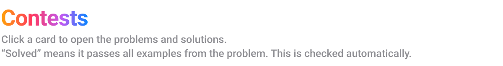
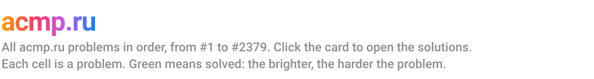
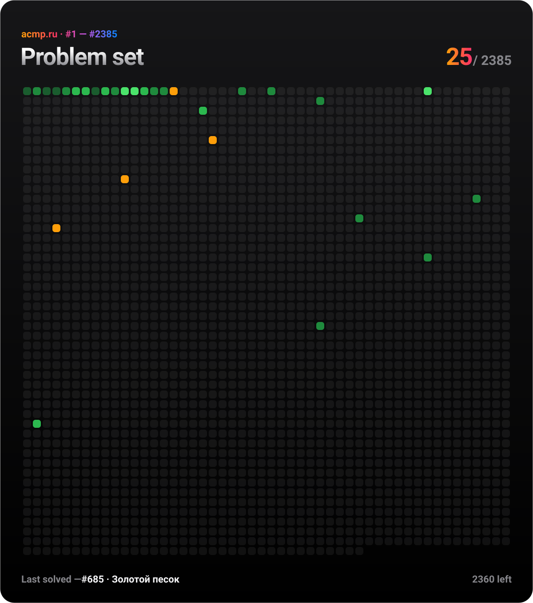
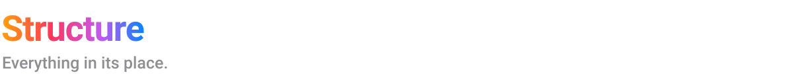
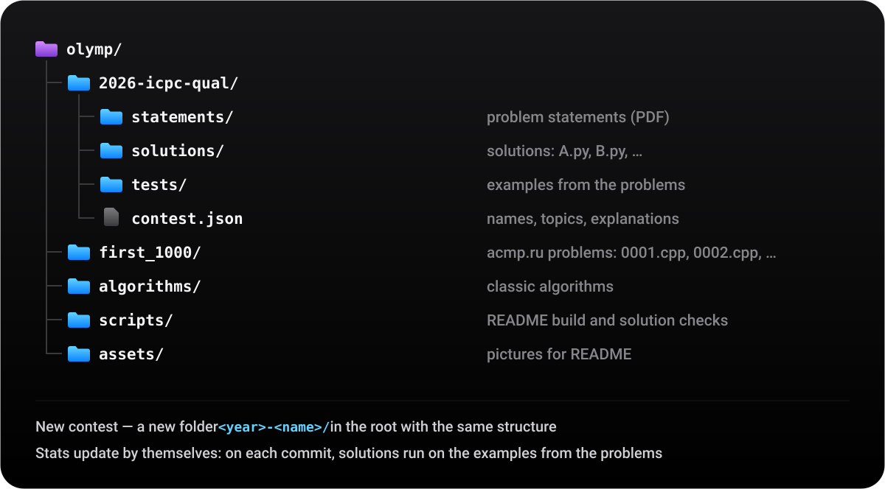
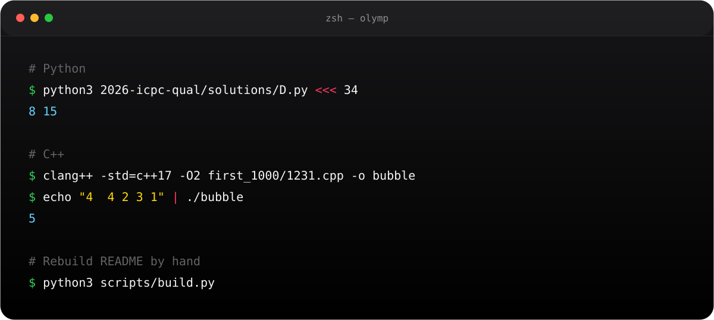

<!-- This file is built automatically: python3 scripts/build.py. Edits by hand will be lost. -->
<p align="center"><b>English</b> &nbsp;|&nbsp; <a href="README.ru.md">Русский</a></p>

<a href="#contests"></a>

<p align="center">
  <a href="#contests">Contests&nbsp;›</a>&emsp;
  <a href="#acmp">acmp.ru&nbsp;›</a>&emsp;
  <a href="#structure">Structure&nbsp;›</a>&emsp;
  <a href="#run">Run&nbsp;›</a>
</p>

<br>



<br>
<br>


<br>

<a name="contests"></a>


<a href="CF-R(1129)"></a>

<a href="2026-icpc-qual"></a>

<br>
<br>

<a name="acmp"></a>


<a href="https://a1tvv.github.io/olymp/"></a>

<br>
<br>

<a name="structure"></a>




<br>
<br>

<a name="run"></a>




<details>
<summary>Copy the commands</summary>
<br>

```bash
# Python
python3 2026-icpc-qual/solutions/D.py <<< 34
# 8 15

# C++
clang++ -std=c++17 -O2 acmp.ru/1231.cpp -o bubble
echo "4  4 2 3 1" | ./bubble
# 5

# Rebuild README by hand
python3 scripts/build.py
```

</details>

<br>


<p align="center">
  <sub>Made with ☕ and <code>-O2</code> &nbsp;·&nbsp; <a href="https://github.com/a1tvv">@a1tvv</a></sub>
</p>
